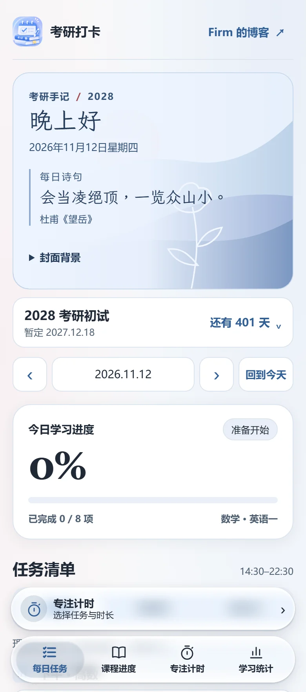
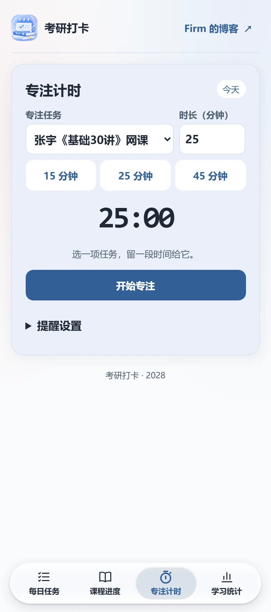

# 考研打卡 · Study Check-in

把今天要学的内容排好，专注完成一项，再回顾这一周走了多远。

一个面向考研备考的学习工具，集每日计划、课程进度、专注计时和学习统计于一体。内置 2028 考研倒计时和数学、英语一学习安排，也可以按自己的科目和节奏制定计划。**打开即用，无需注册。**

**[在线使用](https://study.xli-tong.cloud/)** · **[GitHub Pages 预览](https://lxtfirm.github.io/study-checkin/)** · **[提交反馈](https://github.com/lxtfirm/study-checkin/issues/new)**

  
  

## 你可以用它做什么

| 功能 | 日常用法 |
| --- | --- |
| **每日计划** | 两套常规计划可改名、增删任务，修改从今天起沿用。也可选「自定义」单独安排某一天。手机上左滑任务查看「编辑」和「删除」，电脑上点任务右侧的「···」。 |
| **课程进度** | 在独立的课程卡片上更新已学课时。内置张宇《基础30讲》，也可以添加自己的课程。 |
| **专注计时** | 选一个任务，设置时长，支持暂停、继续和提前结束。实际专注时长计入当天统计。 |
| **学习记录** | 记录学习笔记、正确率、词汇量和每日复盘，查看最近 7 天的完成率、连续打卡和本周专注时长。 |
| **考研倒计时** | 查看距离初试还有多少天，也可自行调整目标日期。首页支持自定义封面。 |

手机和电脑浏览器均可使用。网页首次加载并完成离线缓存后，可以断网打开和打卡。

## 开始使用

1. 打开[在线站点](https://study.xli-tong.cloud/)，在「每日任务」选择适合今天的计划。
2. 在「专注计时」选择任务和时长。结束后勾选已完成的任务，学习记录会保存在当前设备。
3. 可以把它添加到主屏幕，像 App 一样打开。iPhone 用 Safari 打开页面，选择「分享 → 添加到主屏幕」。

### 锁屏提醒

普通打卡和网页内计时无需连接码。后台锁屏推送需要支持 Web Push 的浏览器、通知授权，以及站点管理员提供的连接码。每台设备的每个浏览器首次连接一次即可。

- **iPhone**：从主屏幕图标打开，再进入「专注计时 → 提醒设置」，选择「连接并开启锁屏推送」。
- **安卓**：可用 Chrome 打开，进入相同的设置并允许通知。
- **GitHub Pages 预览**：提供打卡、统计和网页内计时。后台锁屏推送由独立部署的服务提供。

[WebKit 主屏幕推送说明](https://webkit.org/blog/13878/web-push-for-web-apps-on-ios-and-ipados/)

### 学习记录与备份

常规计划、打卡、课程和笔记保存在当前浏览器。换设备、换网址或清除网站数据前，在「学习统计」选择「导出 JSON」，再到新环境导入。导入会提示确认覆盖同一天的记录。同日期的常规计划仅在备份包含对应计划时覆盖。封面图片留在原设备，需在新设备重新选择。

开启后台推送后，服务器保存设备订阅和提醒调度状态。现有版本使用本地学习记录，跨设备迁移通过 JSON 完成。

## 自行部署

前端使用原生 HTML、CSS、JavaScript 和 Service Worker。后台推送使用 Node.js、SQLite 和 Web Push。

- **本地体验**：在项目根目录运行 `python -m http.server 8000`，打开 [localhost:8000](http://localhost:8000/)。
- **静态发布**：Fork 仓库后，在 GitHub 的 **Settings → Pages** 中选择从分支发布，使用 `main` 和 `/(root)`。发布后从 Pages 设置打开 HTTPS 地址。
- **部署后台推送**：需要 Node.js 24 及以上版本、HTTPS 和同站点的 API 转发。SQLite 文件在服务启动时创建。按[后端部署指南](backend/README.md)操作，并为自己的站点生成连接码。

开发时可在 `backend` 目录运行 `npm ci` 和 `npm test`，验证提醒调度、取消和重启恢复。发布新版时，同步更新 `sw.js` 的缓存版本和 `index.html` 中 `release-dialog` 的版本编号与公告内容。每个浏览器打开新版时会弹出公告，确认后仍可从页脚回看。

## 反馈与参与

欢迎提交 [Issue](https://github.com/lxtfirm/study-checkin/issues/new) 或 Pull Request。如果遇到问题，请附上设备、浏览器、复现步骤和预期结果。如果想推荐给备考同学，分享[在线使用地址](https://study.xli-tong.cloud/)即可。
